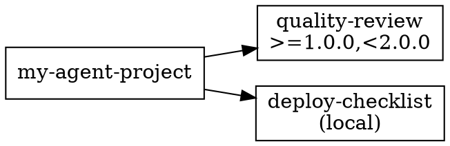

# Phase 4, Task 1: `agx graph` — Dependency Graph Visualization

## Overview

Add `agx graph` command that outputs a visual dependency tree showing the relationships between all assets in the project.

## Implementation

### 1. Create `src/cli/graph.rs`

```rust
#[derive(Debug, Args)]
pub struct GraphArgs {
    /// Output format: tree (default), dot (Graphviz DOT)
    #[arg(long, default_value = "tree")]
    pub format: String,
}
```

### 2. Tree format (default)

Print a visual tree similar to `cargo tree`:

```
my-agent-project v0.1.0
├── [backends]
│   ├── claude-code (strict, model: sonnet)
│   └── gemini-cli (permissive)
├── [plugins]
│   ├── quality-review >=1.0.0,<2.0.0 (registry: official)
│   │   ├── skill: code-review
│   │   └── agent: reviewer-bot
│   └── custom-plugin (git: github.com/..., tag: v3.0.0)
├── [skills]
│   ├── deploy-checklist (local: ./skills/deploy-checklist)
│   └── remote-skill (git: github.com/..., tag: v1.0.0)
├── [agents]
│   ├── my-reviewer (local: ./agents/my-reviewer.md, model: opus)
│   └── remote-agent (git: github.com/..., tag: v2.0.0)
└── [mcp-servers]
    ├── playwright (url: https://mcp.playwright.dev/sse)
    └── filesystem (command: npx @anthropic-ai/mcp-server-filesystem)
```

Use `console::style` for colors:
- Section headers: bold
- Local sources: green
- Git sources: yellow
- Registry sources: cyan
- Connectors (├── └── │): dim

If the lockfile exists, enhance the tree with resolved versions and commit SHAs from the lockfile (show them in dim after the source info).

### 3. DOT format (`--format dot`)

Output Graphviz DOT format for visualization with external tools:



### 4. Register the command

- Add `pub mod graph;` in `src/cli/mod.rs`
- Add `Graph(graph::GraphArgs)` variant to `Commands` enum
- Add dispatch arm

### Tests

- Test tree output contains expected section headers and asset names
- Test DOT output is valid (contains "digraph", expected node names)
- Test with empty manifest (just name + backends)
- Test with full manifest (plugins, skills, agents, mcp-servers)

## Important Notes
- Only modify: `src/cli/graph.rs` (new), `src/cli/mod.rs`
- No new dependencies needed — just string formatting
- Use the existing source formatting functions from `src/cli/list.rs` as reference (but don't import from there — duplicate the formatting logic or keep it simple)
